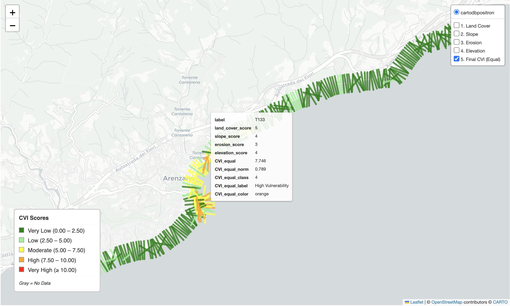
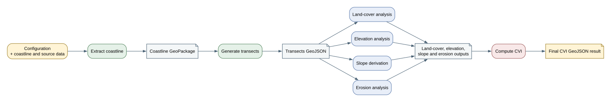

# HARTIS D001 Contribution Draft

Status: final contribution draft, updated on 2026-10-13; pending only external review updates
Role: D100 Workflow Profiler
Organisation: HARTIS Integrated Nautical Services P.C.

## Part A — Main Report Section

### HARTIS Integrated Nautical Services P.C.

**Deliverable:** D100 Workflow Profiler

#### Overview

HARTIS is profiling a real Coastal Vulnerability Index (CVI) workflow as a provenance chain of geospatial processing activities. The workflow is a containerised, step-based CWL workflow that uses coastline geometry, transects, land-cover data, elevation data and erosion information to produce coastal vulnerability results. The HARTIS contribution tests a working provenance representation against this workflow and identifies the inputs, outputs, processing activities, parameters and relationships that need to be recorded for reproducible workflow execution.

The focused provenance example describes transect generation from coastline geometry. A two-step chain extends it by connecting coastline extraction to transect generation, including the AOI, Nominatim and Overpass dependencies. A normalized full-workflow candidate separates the workflow definition, eight design-time processing plans, eight runtime activities and the input, intermediate, external and output entities. The contribution also includes provisional generic Geoprocessing Activity definitions derived from the AI-DGGS Flood Impact Index pilot, together with a demonstrator record showing DGGS cell indexing before the FII calculation.

#### Challenges

The main challenge was describing a real CVI workflow in a way that is useful for this application but can also be reused for other workflows. We therefore had to distinguish general processing steps, such as slope and raster analysis, from application-specific steps, such as coastline acquisition and final CVI scoring. We also had to connect the planned workflow structure with the activities and outputs produced during an actual run. Since the Register model and URI conventions were still being developed during the pilot, we used provisional process-type identifiers and documented these assumptions in the examples.

#### Figure

Figure: CVI workflow result showing coastal transects and the calculated equal-weight CVI classification.

Figure: CVI workflow provenance chain from inputs through coastline extraction, transect generation and indicator calculations to the final CVI result.

#### Future Work

After OSPD 2026, HARTIS plans to assess the methodology across additional, more mature workflow platforms and in the context of European digital-twin infrastructure for coastal and marine applications. The methodology combines workflow profiling, explicit description of processing activities and inputs/outputs, provenance capture, validation evidence and reproducible execution. The aim will be to evaluate its portability, interoperability and reproducibility across different workflows and execution environments.

## Part B — Contribution Details

### B1. Contribution Overview

This contribution combines a primary workflow-profiling case with a supporting activity-definition case. Together, they show both how provenance can be captured for a complete geospatial workflow and how reusable processing types can be derived from a real application.

The contribution has two connected evidence tracks:

1. The CVI workflow is the primary D100 profiling case. It provides a non-trivial chain of activities, inputs, intermediate entities and final outputs.
2. The AI-DGGS FII workflow provides additional evidence for generic Geoprocessing Activity definitions that are used in a real spatial processing workflow.

The repository evidence artefacts include:

- the [CVI workflow definition](https://github.com/hartis-org/cvi-workflow/blob/ospd2026-d100/cvi_workflow.cwl) and [job inputs](https://github.com/hartis-org/cvi-workflow/blob/ospd2026-d100/job_cvi.yaml);
- the [coastline-to-transects provenance chain](https://github.com/hartis-org/cvi-workflow/blob/ospd2026-d100/ospd2026/provenance/cvi_coastline_to_transects_provenance_chain.json);
- the [normalised full-workflow provenance candidate](https://github.com/hartis-org/cvi-workflow/blob/ospd2026-d100/ospd2026/provenance/cvi_full_workflow_design_runtime_entities.json), with separate plans, runtime activities and entities;
- the [HARTIS provenance Building Block source](https://github.com/hartis-org/cvi-workflow/tree/ospd2026-d100/ospd2026/building-block/_sources/hartis-provenance/cvi-workflow), including its schema, example and validation tests;
- the [Geoprocessing Activity definitions and `PRV004` demonstrator](https://github.com/hartis-org/cvi-workflow/blob/ospd2026-d100/ospd2026/register/geoprocessing-activities.jsonld); and
- the [artifact manifest](https://github.com/hartis-org/cvi-workflow/blob/ospd2026-d100/ospd2026/validation/cvi_workflow_artifact_manifest.json), with file sizes and SHA-256 hashes.

### B2. Provenance Implementation

The provenance representation models each processing activity with:

- an activity identifier and label;
- a provisional `processType` value;
- `used` input entities;
- `generated` output entities;
- `qualifiedUsage` entries for input roles;
- links to the workflow script and container;
- parameters needed to understand or reproduce the operation; and
- links to other activities through the entities they use and generate.

The focused `generate-transects` example consumes `coastline.gpkg` and produces `transects.geojson`. It records parameters such as transect spacing, transect length, processing CRS and output CRS, so the example describes more than just the existence of an output file. The two-step chain adds `extract-coastline` and keeps the AOI, Nominatim response and Overpass response visible as upstream entities. The provenance Building Block candidate extends this pattern across the eight CVI steps and separates the workflow definition, design-time plans, runtime activities and data entities.

### B3. Process Types and Register Contribution

The CVI workflow produced candidate terms for configuration validation, coastline data acquisition, transect generation, land-cover analysis, slope derivation, erosion-data integration, elevation analysis and vulnerability-index scoring. These terms are kept provisional while the shared Register model and URI conventions are being established.

The AI-DGGS FII pilot supplied additional generic activity definitions based on operations actually performed by that workflow:

- `GA018` Slope derivation;
- `GA019` D8 flow-direction derivation;
- `GA020` D8 flow-accumulation derivation;
- `GA021` Watershed/catchment delineation;
- `GA022` Stream-network extraction;
- `GA023` Distance-to-feature calculation;
- `GA024` Zonal raster statistics;
- `GA025` Raster sampling at points;
- `GA026` DGGS cell indexing.

These definitions are intentionally separate from the application-specific FII score. The `PRV004` demonstrator shows how spatial inputs and a grid resolution are used to produce DGGS cell identifiers for the subsequent FII calculation.

### B4. Register Implementation

The contribution provides candidate definitions and usage evidence for the Register; it does not implement the Register itself. The entries are provisional and are intended to follow the shared Register and Building Block conventions as the intake process and URI patterns are finalised.

### B5. Validation Evidence

The validation combines structural checks with a real workflow execution. It checks that:

- each activity has identifiable inputs and outputs;
- intermediate entities connect one processing step to the next;
- input roles can be recorded with `qualifiedUsage`;
- activity parameters are available for the representative transect-generation step;
- the full CVI candidate contains eight plans and eight runtime activities;
- every runtime activity references a design-time plan;
- the final CVI activity consumes the four indicator outputs;
- the provenance entities correspond to concrete repository files recorded with their size and SHA-256 hash; and
- the generic activity definitions correspond to operations present in the AI-DGGS FII workflow.

The structural checks pass, and the schema-based provenance Building Block passes the repository validation workflow. Its upstream review is tracked through the shared Open Science Building Blocks pull request. Final Register identifiers remain provisional because the shared URI pattern is still being settled.

A [successful GitHub Actions run](https://github.com/hartis-org/cvi-workflow/actions/runs/37607636698) executed the containerised CWL workflow end to end. It produced the coastline GeoPackage, transects, the four indicator outputs and the final `transects_with_cvi_equal.geojson` result. The run also generated a CWLProv Research Object containing `primary.cwlprov.json` and `primary-output.json`. The [sanitized evidence export](https://github.com/hartis-org/cvi-workflow/tree/generated-evidence/37619629660/ospd2026/evidence/runs/37619629660) passed the credential-value check and is suitable for retaining as a reproducibility record.

### B6. Provenance Encoding

The examples use a JSON/JSON-LD-oriented representation with explicit identifiers, types, activities, entities and relationships. The focused evidence demonstrates a two-step chain, while the provenance Building Block candidate represents the complete CVI workflow and separates the workflow definition, design-time plans, runtime activities and data entities. This provides a concrete profile for the CVI case while leaving room to align with the common OSPD provenance profile and any required Building Block transformations.

### B7. Findings And Lessons Learned

The CVI workflow shows that a useful provenance profile must distinguish a reusable processing operation from application-specific scoring logic. It must also preserve the relationship between an activity definition, the runtime activity that implements it, its input and output entities, and the software or container that executed it.

The FII workflow shows that generic activity definitions are strongest when they are derived from real operations such as D8 processing, zonal statistics and DGGS indexing, rather than invented only for the Register.

### B8. Recommendations

- Keep generic activity definitions separate from application-specific index calculations.
- Allow a workflow profile to link a runtime activity to a registered or provisional process type.
- Support both a single processing step and a connected workflow chain.
- Provide clear validation feedback for activities, entities and qualified-usage structures.

### B9. References

- HARTIS CVI workflow definition and execution inputs: [`cvi_workflow.cwl`](../../cvi_workflow.cwl) and [`job_cvi.yaml`](../../job_cvi.yaml).
- HARTIS coastline-to-transects provenance chain: [`cvi_coastline_to_transects_provenance_chain.json`](../provenance/cvi_coastline_to_transects_provenance_chain.json).
- HARTIS normalized full-workflow provenance candidate: [`cvi_full_workflow_design_runtime_entities.json`](../provenance/cvi_full_workflow_design_runtime_entities.json).
- HARTIS full-workflow provenance Building Block candidate: [`bblock.json`](../building-block/_sources/hartis-provenance/cvi-workflow/bblock.json), [`schema.yaml`](../building-block/_sources/hartis-provenance/cvi-workflow/schema.yaml), [`examples.yaml`](../building-block/_sources/hartis-provenance/cvi-workflow/examples.yaml) and [`example.json`](../building-block/_sources/hartis-provenance/cvi-workflow/example.json).
- HARTIS activity definitions and `PRV004` demonstrator record: [`geoprocessing-activities.jsonld`](../register/geoprocessing-activities.jsonld).
- HARTIS artifact manifest with file sizes and SHA-256 checksums: [`cvi_workflow_artifact_manifest.json`](../validation/cvi_workflow_artifact_manifest.json).
- W3C PROV-O: https://www.w3.org/TR/prov-o/.
- Common Workflow Language Specification: https://www.commonwl.org/specification/.
- CWLProv provenance profile: https://github.com/common-workflow-language/cwlprov.
- OGC Location Building Blocks: https://blocks.ogc.org/.
- OGC API - Processes: https://ogcapi.ogc.org/processes/overview.html.
